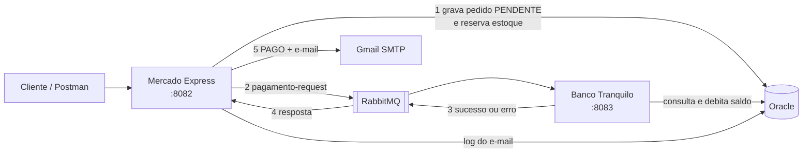

# Mercado Express — Checkpoint 5 (Parte 1 + Parte 2)

FIAP — Faculdade de Informática e Administração Paulista
Curso de Tecnologia em Análise e Desenvolvimento de Sistemas (TDS) — Java Advanced
Professor: Dr. Marcel Stefan Wagner

Aplicação web para uma empresa do tipo **mercado express**, feita com **Spring Boot**, **Spring MVC**, **Thymeleaf**, **Spring Security**, **RabbitMQ** e banco **Oracle**.

## Integrantes

| Nome | RM |
|---|---|
| Matheus Moya de Oliveira | RM 562822 |
| Luisa Ganasevici de Abreu | RM 563403 |
| Ana Carolina Pereira Fontes | RM 562145 |

**IDE utilizada:** IntelliJ IDEA

---

## Onde está cada parte (branches)

As duas partes do CP5 estão em **branches separadas**. Esta página (`main`) reúne a documentação das duas. O código de cada parte fica na sua branch:

| Parte | O que é | Branch | Link |
|---|---|---|---|
| **Parte 1** | Spring Security MVC, CRUD, login/cadastro e **deploy na Render** | `developCP5/parte-1` | https://github.com/luisa-ganasevici/mercado-express/tree/developCP5/parte-1 |
| **Parte 2** | Microsserviços com **RabbitMQ**, Banco Tranquilo, e-mail e dashboard | `developCP5/parte-2` | https://github.com/luisa-ganasevici/mercado-express/tree/developCP5/parte-2 |

- **Deploy da Parte 1 (Render):** https://mercado-express-957x.onrender.com (a Render segue a branch `developCP5/parte-1`)
- **Vídeo da Parte 2 (5 a 7 min):** https://youtu.be/kaKKiUpkOSM

Para baixar cada parte:
```bash
git clone https://github.com/luisa-ganasevici/mercado-express.git
cd mercado-express
git checkout developCP5/parte-1   # Parte 1
git checkout developCP5/parte-2   # Parte 2
```

> A `main` não é usada para rodar o CP5. Ela guarda a documentação e o histórico das entregas anteriores.

---

## Índice

- [Parte 1 — Spring Security MVC + Deploy](#parte-1--spring-security-mvc--deploy)
- [Parte 2 — Microsserviços com RabbitMQ](#parte-2--microsserviços-com-rabbitmq)

---

# Parte 1 — Spring Security MVC + Deploy

> Código na branch `developCP5/parte-1`.

### Tecnologias

| Tecnologia | Uso |
|---|---|
| Java 21 | Linguagem |
| Spring Boot | Framework principal |
| Maven | Dependências e build |
| Spring MVC + Thymeleaf | Telas renderizadas no servidor |
| Spring Security | Login, cadastro, papéis e proteção de rotas |
| Spring Data JPA (Hibernate) | Persistência |
| Flyway | Versionamento do banco (`db/migration`) |
| Oracle (ojdbc11) | Banco de dados (Oracle FIAP) |
| Lombok | Menos código repetitivo |
| Docker | Empacotamento para o deploy |

> **Sobre o banco:** o enunciado sugere PostgreSQL, mas permite usar o SQL Developer. Usamos o **Oracle da FIAP**, acessado pelo SQL Developer.

---

### Arquitetura

```
br.com.fiap.mercadoexpress
├── controller   -> recebe a requisição e devolve o nome do template Thymeleaf
├── service      -> regras de negócio
├── repository   -> acesso a dados (Spring Data JPA)
├── entity       -> tabelas (Mercado, Usuario)
├── config       -> Spring Security (SecurityConfig, LoginSuccessHandler)
└── exception    -> tratamento de erros
```

Os controllers usam `@Controller` e retornam templates HTML (não JSON).

---

### Banco de dados

Tabelas criadas pelo Flyway (`src/main/resources/db/migration`):

| Tabela | Conteúdo |
|---|---|
| `TDS_TB_MERCADO` | Produtos: id, nome, tipo, setor, tamanho, cor, preço, estoque, disponível |
| `TDS_TB_USUARIO` | Usuários: id, username, e-mail, senha (BCrypt), role (`CLIENTE` ou `ADMIN`) |

A conexão é configurada em `application.yml`. **Usuário e senha do banco não ficam no código**: vêm das variáveis de ambiente `DB_USERNAME` e `DB_PASSWORD`.

---

### Spring Security

- **Tela de login própria** (`login.html`), diferente da padrão do Spring Security.
- **Cadastro (Sign Up)** em `/cadastro`: quem não tem conta cria o perfil, que é salvo em `TDS_TB_USUARIO`, e depois faz login.
- **Senhas** com hash BCrypt.
- Após o login, o usuário vai para a tela restrita (`/home/privado`).
- **Dois tipos de usuário:**
    - `CLIENTE` (todo cadastro novo): vê produtos e compra.
    - `ADMIN`: cria, edita e exclui produtos e gerencia usuários.
- **Landing page:** `index.html` (`/home`).
- **Acesso negado:** página própria em `/acesso-negado`.

| Nível | Rotas | Quem acessa |
|---|---|---|
| Público | `/`, `/home`, `/cadastro`, `/login`, `/acesso-negado`, `/css/**` | Qualquer visitante |
| Público (leitura) | `GET /produtos`, `GET /produtos/{id}` | Qualquer visitante |
| Autenticado | `/produtos/{id}/comprar` | `CLIENTE` ou `ADMIN` |
| Somente ADMIN | `/produtos/**`, `/usuarios/**`, `/admin/**` | `ADMIN` |

O primeiro `ADMIN` é definido direto no banco (coluna `ROLE`). Depois, um `ADMIN` promove outros usuários pela tela `/usuarios`.

---

### Telas e CRUD

Tudo acontece por botões e links na interface, sem Postman.

| Operação | Como fazer |
|---|---|
| **Create** | Botão "Novo produto" (ADMIN) em `/produtos` → formulário → `POST /produtos` |
| **Read** | `/produtos` lista tudo e tem busca por nome; "Comprar" abre o produto |
| **Update** | Botão "Editar" (ADMIN) → `POST /produtos/{id}/editar`. A compra também baixa o estoque |
| **Delete** | Botão "Excluir" (ADMIN) → `POST /produtos/{id}/excluir` |

**Exclusão lógica:** o produto é marcado com `disponivel = false` e o registro continua no banco. Isso preserva o histórico.

---

### Endpoints

| Método | Rota | Acesso | Descrição |
|---|---|---|---|
| GET | `/`, `/home` | Público | Landing page |
| GET | `/home/privado` | Autenticado | Tela restrita após login |
| GET/POST | `/login` | Público | Login |
| GET/POST | `/cadastro` | Público | Cria usuário (`CLIENTE`) |
| GET | `/produtos` | Público | Lista e busca produtos |
| GET | `/produtos/{id}` | Público | Detalhe do produto |
| GET/POST | `/produtos/novo`, `/produtos` | ADMIN | Cria produto |
| POST | `/produtos/{id}/editar` | ADMIN | Edita produto |
| POST | `/produtos/{id}/excluir` | ADMIN | Exclusão lógica |
| GET/POST | `/produtos/{id}/comprar` | Autenticado | Compra e baixa de estoque |
| GET | `/usuarios` | ADMIN | Lista usuários |
| POST | `/usuarios/{id}/promover` | ADMIN | Promove a `ADMIN` |
| POST | `/usuarios/{id}/rebaixar` | ADMIN | Rebaixa a `CLIENTE` |

---

### Como rodar localmente

**Pré-requisitos**
- JDK 21 ou superior
- Maven (ou o `mvnw` do projeto)
- Acesso ao Oracle da FIAP

**Passo a passo**
1. Clone o repositório e troque para a branch da Parte 1:
   ```bash
   git clone https://github.com/luisa-ganasevici/mercado-express.git
   cd mercado-express
   git checkout developCP5/parte-1
   ```
2. Defina as variáveis de ambiente:
    - `DB_USERNAME` = usuário do Oracle (ex.: `RM563403`)
    - `DB_PASSWORD` = senha do Oracle

   No IntelliJ: **Run → Edit Configurations →** campo **Environment variables**:
   `DB_USERNAME=RM563403;DB_PASSWORD=sua_senha`
3. Execute a classe `MercadoExpressApplication`. O Flyway cria as tabelas na primeira execução.
4. Abra `http://localhost:8082`.
5. Crie uma conta em `/cadastro` e entre em `/login`.

---

### Deploy

- Plataforma: **Render** (Web Service com Docker).
- Link: https://mercado-express-957x.onrender.com
- O `Dockerfile` tem duas etapas: compila com Maven e roda só o `.jar` em uma imagem JRE enxuta.
- A Render segue a branch `developCP5/parte-1`.
- As variáveis `DB_USERNAME` e `DB_PASSWORD` ficam no painel da Render.
- A porta vem da variável `PORT` (`server.port=${PORT:8082}`).
- No plano gratuito, a primeira requisição após um período parado pode levar cerca de 1 minuto.

---

# Parte 2 — Microsserviços com RabbitMQ

> Código na branch `developCP5/parte-2`.

### Visão geral

São **duas aplicações Spring Boot** que se comunicam só pelo RabbitMQ:

| Aplicação | Pasta | Porta | Papel |
|---|---|---|---|
| **Mercado Express** (loja) | raiz do repositório | 8082 | Telas, compra, API de pedidos, e-mail, dashboard |
| **Banco Tranquilo** (worker) | `banco-tranquilo-worker/` | 8083 | Consome pedidos, aprova ou recusa, tela de saldo |



---

### Tecnologias

| Tecnologia | Uso |
|---|---|
| Java 21 (rodando também em 25) | Linguagem |
| Spring Boot 4 (Spring Initializr) | Base das duas aplicações |
| Spring AMQP / RabbitMQ 3 | Mensageria (exchanges, queues, bindings, `@RabbitListener`) |
| Docker | Sobe o RabbitMQ |
| Spring Data JPA, Flyway | Banco da loja e migrations |
| Spring JDBC (`JdbcTemplate`) | Banco do worker |
| Spring Security (form login + HTTP Basic) | Telas e API |
| Spring Mail (Gmail SMTP) | E-mail de confirmação |
| Thymeleaf, Lombok | Telas e código mais limpo |
| Oracle (FIAP) | Banco de dados |

> O enunciado prefere PostgreSQL, mas permite Oracle SQL Developer. Mantivemos o **Oracle** da Parte 1.

---

### Estrutura do repositório

```
mercado-express/
├── src/                          # loja (Mercado Express)
│   └── main/java/br/com/fiap/mercadoexpress
│       ├── controller/           # telas, API de pedidos, dashboard, ponte para o banco
│       ├── service/              # PedidoService, EmailService
│       ├── messaging/            # produtor e consumidores do RabbitMQ
│       ├── entity/               # Pedido, EmailLog, Mercado, Usuario
│       └── config/               # RabbitConfig, SecurityConfig
├── banco-tranquilo-worker/       # microsserviço do banco
│   └── src/main/java/br/com/fiap/banco_tranquilo_worker
│       ├── config/               # RabbitConfig
│       ├── consumer/             # PagamentoRequestConsumidor
│       ├── service/              # ContaService (regras do banco)
│       ├── controller/           # BancoController (tela de saldo)
│       └── dto/                  # PagamentoRequest, PagamentoResponse
├── docker/docker-compose.yml     # RabbitMQ
└── docs/                         # coleção do Postman
```

---

### Fluxo da compra

1. O cliente compra pela tela ou pela API. A loja **grava o pedido como `PENDENTE`** e **reserva o estoque** na hora, com um `UPDATE` atômico que impede vender mais do que existe.
2. A loja envia `PagamentoRequest` (pedido, valor, e-mail) para a fila `pagamento-request-queue`.
3. O **Banco Tranquilo** consome a mensagem, procura a conta pelo **e-mail** e decide.
4. Ele responde na fila de **sucesso** ou de **erro**.
5. A loja consome a resposta:
    - **Aprovado:** pedido vira `PAGO`, o **e-mail é enviado** e o envio é gravado em `TDS_TB_EMAIL_LOG`.
    - **Recusado:** pedido vira `RECUSADO`, com o **motivo**, e o **estoque volta**.
6. O cliente acompanha em **Meus pedidos** (a tela atualiza sozinha a cada 5 segundos).

**Se o Banco Tranquilo estiver fora do ar**, os pedidos ficam `PENDENTE` na fila e são processados quando ele volta (a mensagem não se perde).

Se a loja não conseguir enviar a mensagem para o RabbitMQ, o pedido é recusado na hora, com o motivo "Falha ao contatar o Banco Tranquilo", e o estoque volta.

---

### RabbitMQ: exchanges e filas

Todas as exchanges são do tipo `direct`, duráveis. As mensagens viajam em **JSON**.

| Exchange | Routing key | Queue | Quem publica → quem consome |
|---|---|---|---|
| `pagamento-request-exchange` | `pagamento-request-rout-key` | `pagamento-request-queue` | Loja → Banco |
| `pagamento-response-sucesso-exchange` | `pagamento-response-sucesso-rout-key` | `pagamento-response-sucesso-queue` | Banco → Loja |
| `pagamento-response-erro-exchange` | `pagamento-response-erro-rout-key` | `pagamento-response-erro-queue` | Banco → Loja |

**Requisição** (loja → banco):
```json
{
  "pedidoId": 16,
  "valor": 39.99,
  "email": "cliente@email.com"
}
```

**Resposta de sucesso** (banco → loja):
```json
{
  "pedidoId": 16,
  "status": "APROVADO",
  "mensagem": "Pagamento aprovado"
}
```

**Resposta de erro** (banco → loja):
```json
{
  "pedidoId": 17,
  "status": "RECUSADO",
  "mensagem": "Saldo insuficiente"
}
```

Painel do RabbitMQ: http://localhost:15672 (usuário `guest`, senha `guest`).

---

### Regras do Banco Tranquilo

O Banco Tranquilo tem a tabela `TDS_TB_CONTA_BANCO` (e-mail, titular, saldo). A **ligação entre o cliente da loja e a conta é o e-mail** do cadastro.

| Situação | Resultado | Mensagem |
|---|---|---|
| Não existe conta com o e-mail | Recusado | `Conta nao encontrada no Banco Tranquilo` |
| Saldo menor que o valor | Recusado | `Saldo insuficiente` |
| Saldo suficiente | **Aprovado** e o valor é debitado | `Pagamento aprovado` |

O débito usa `SELECT ... FOR UPDATE`, então duas compras ao mesmo tempo não gastam o mesmo saldo.

---

### E-mail de confirmação

- Enviado **somente quando o pagamento é aprovado**, para o e-mail do cliente que comprou.
- Assunto: `Pagamento confirmado - Pedido N`.
- Envio por **Gmail SMTP** (`smtp.gmail.com:587`, STARTTLS) usando uma **senha de app** do Google.
- Cada envio é gravado na tabela **`TDS_TB_EMAIL_LOG`**: pedido, destinatário, assunto, status (`ENVIADO` ou `FALHA`), mensagem de erro e data/hora. Assim há controle do que foi enviado.

---

### Telas

| Tela | Endereço | Quem acessa |
|---|---|---|
| Produtos e compra | `http://localhost:8082/produtos` | Todos / logado |
| **Meus pedidos** (status e motivo) | `http://localhost:8082/meus-pedidos` | Cliente logado |
| **Ir para o banco** (botão na tela do cliente) | `http://localhost:8082/meu-banco` | Cliente logado |
| **Banco Tranquilo**: ver saldo e adicionar saldo | `http://localhost:8083/banco` | Cliente |
| **Dashboard da gerência** | `http://localhost:8082/admin/dashboard` | ADMIN |

O **dashboard da gerência** mostra: total de pedidos, pedidos pagos, vendas, custo e lucro, além de gráficos de **vendas por produto**, **lucro por produto**, **estoque atual** e **pedidos por status**, e a **lista de compras realizadas**.

Na tela do banco, o cliente consulta o saldo e adiciona saldo (sem regras, só soma). O botão "Voltar para a loja" leva de volta ao Mercado Express.

---

### API REST de pedidos e exemplo no Postman

Autenticação **HTTP Basic** (mesmo usuário e senha do login da loja).

| Método | Rota | Descrição | Retorno |
|---|---|---|---|
| POST | `/api/pedidos` | Cria um pedido de compra | `202 Accepted` com o pedido `PENDENTE` |
| GET | `/api/pedidos` | Lista os pedidos do usuário | `200` |
| GET | `/api/pedidos/{id}` | Consulta um pedido | `200` ou `404` |

**Requisição JSON de compra** (para o Postman ou Insomnia):
```http
POST http://localhost:8082/api/pedidos
Authorization: Basic <usuario:senha>
Content-Type: application/json

{
  "produtoId": 1,
  "quantidade": 2
}
```

**Resposta (`202`):**
```json
{
  "id": 18,
  "produto": "Saia",
  "quantidade": 2,
  "valorTotal": 79.98,
  "status": "PENDENTE",
  "motivo": null
}
```

Depois de alguns segundos, `GET /api/pedidos/18` retorna `"status": "PAGO"` com `"motivo": "Pagamento aprovado"` (ou `RECUSADO`, com o motivo).

Se o produto não existir ou o estoque acabar, a API responde `400` com `{"erro": "Produto indisponivel ou estoque insuficiente"}`.

A coleção do Postman está em `docs/postman/` (arquivo `.json`, para importar).

---

### Banco de dados

| Tabela | Aplicação | Conteúdo |
|---|---|---|
| `TDS_TB_MERCADO` | loja | Produtos, preço, custo e estoque |
| `TDS_TB_USUARIO` | loja | Usuários, e-mail e papel |
| `TDS_TB_PEDIDO` | loja | Pedidos, status e motivo (`MOTIVO`) |
| `TDS_TB_EMAIL_LOG` | loja | Controle de envio de e-mails |
| `TDS_TB_CONTA_BANCO` | worker | Contas do Banco Tranquilo (e-mail, titular, saldo) |

As tabelas da loja são criadas pelo **Flyway** (`V1` a `V5`). A `TDS_TB_CONTA_BANCO` é criada à mão no SQL Developer:

```sql
CREATE TABLE TDS_TB_CONTA_BANCO (
    EMAIL   VARCHAR2(150) PRIMARY KEY,
    TITULAR VARCHAR2(150),
    SALDO   NUMBER(12,2) DEFAULT 0 NOT NULL
);

INSERT INTO TDS_TB_CONTA_BANCO (EMAIL, TITULAR, SALDO) VALUES ('cliente1@email.com', 'Cliente 1', 500);
INSERT INTO TDS_TB_CONTA_BANCO (EMAIL, TITULAR, SALDO) VALUES ('cliente2@email.com', 'Cliente 2', 20);
COMMIT;
```

---

### Como rodar

#### Pré-requisitos
- JDK 21 ou superior
- Maven (ou `mvnw`)
- **Docker Desktop** ligado
- Acesso ao Oracle da FIAP
- Conta Gmail com **verificação em duas etapas** e uma **senha de app** (Conta Google → Segurança → Senhas de app)

#### 1. Variáveis de ambiente
Cada aplicação usa as variáveis abaixo. No IntelliJ: **Run → Edit Configurations →** campo **Environment variables** (**não** use o campo "Active profiles").

| Aplicação | Variáveis |
|---|---|
| Loja | `DB_USERNAME`, `DB_PASSWORD`, `MAIL_USERNAME` (Gmail completo), `MAIL_PASSWORD` (senha de app, 16 letras, sem espaços) |
| Banco Tranquilo | `DB_USERNAME`, `DB_PASSWORD` |

Exemplo na loja:
```
DB_USERNAME=RM563403;DB_PASSWORD=sua_senha;MAIL_USERNAME=seu@gmail.com;MAIL_PASSWORD=abcdefghijklmnop
```

#### 2. Passo a passo (nesta ordem)

0. **Baixe a branch da Parte 2:**
   ```bash
   git clone https://github.com/luisa-ganasevici/mercado-express.git
   cd mercado-express
   git checkout developCP5/parte-2
   ```

1. **RabbitMQ (Docker)**
   ```bash
   docker compose -f docker/docker-compose.yml up -d
   ```
   Confira em http://localhost:15672 (`guest` / `guest`).

2. **Contas do Banco Tranquilo:** rode o SQL da seção seção "Banco de dados" desta Parte 2 no SQL Developer e inclua também a conta do seu usuário da loja (com o mesmo e-mail do cadastro), por exemplo:
   ```sql
   INSERT INTO TDS_TB_CONTA_BANCO (EMAIL, TITULAR, SALDO) VALUES ('seu@email.com', 'Seu Nome', 1000);
   COMMIT;
   ```

3. **Loja:** execute `MercadoExpressApplication` (raiz do repositório). Porta **8082**. O Flyway cria as tabelas na primeira vez.

4. **Banco Tranquilo:** abra a pasta `banco-tranquilo-worker` em outra janela do IntelliJ e execute `BancoTranquiloWorkerApplication`. Porta **8083**.

5. **Teste:**
    - Entre na loja (`http://localhost:8082`), faça login e compre um produto.
    - Veja o pedido em **Meus pedidos**: `PENDENTE` → `PAGO`.
    - Confira o e-mail na caixa de entrada.
    - Para ver a recusa, compre um valor maior que o saldo (ex.: conta com R$ 20).
    - Para recarregar o saldo, use a tela do banco ou o SQL:
      ```sql
      UPDATE TDS_TB_CONTA_BANCO SET SALDO = 1000 WHERE LOWER(EMAIL) = 'seu@email.com';
      COMMIT;
      ```

6. **Demonstração do desacoplamento:** pare o Banco Tranquilo, faça uma compra (fica `PENDENTE` e a mensagem espera na fila do RabbitMQ). Suba o Banco Tranquilo de novo e o pedido vira `PAGO`.

#### Observações
- Os dois apps precisam estar rodando ao mesmo tempo.
- Se o Oracle reclamar de limite de sessões (`ORA-02391`), feche conexões abertas no SQL Developer. Os apps usam um pool pequeno do HikariCP para evitar isso.
- A Parte 2 roda **localmente** (o deploy exigido está na Parte 1).

---

### Segurança

- **Nenhuma credencial vai para o repositório.** Usuário e senha do Oracle, e-mail e senha de app do Gmail vêm de variáveis de ambiente.
- As informações de configuração do banco foram enviadas ao professor separadamente, pelo Teams.
- Senhas dos usuários da loja usam BCrypt.
- A API de pedidos exige autenticação e cada usuário só vê os próprios pedidos.